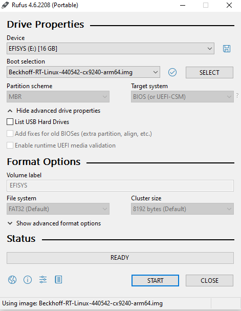
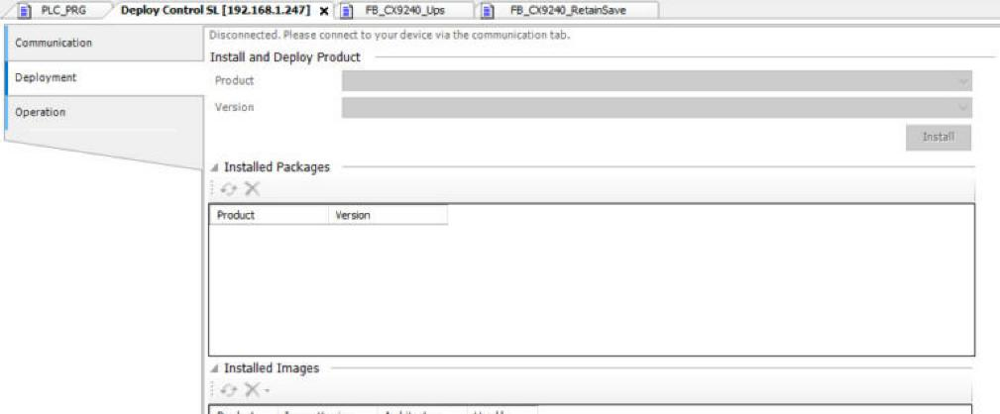
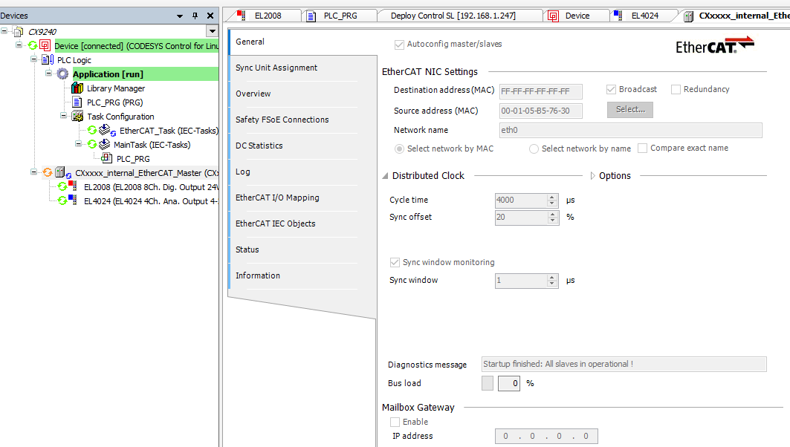
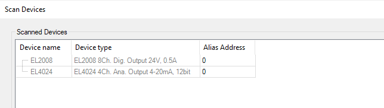
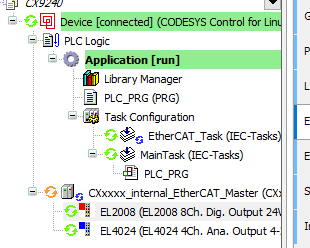
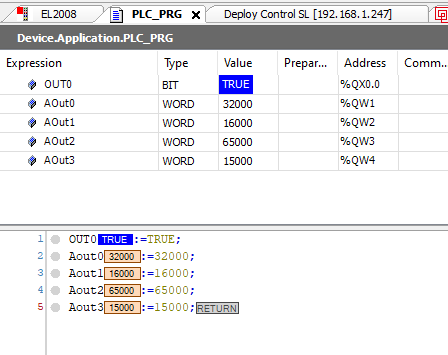
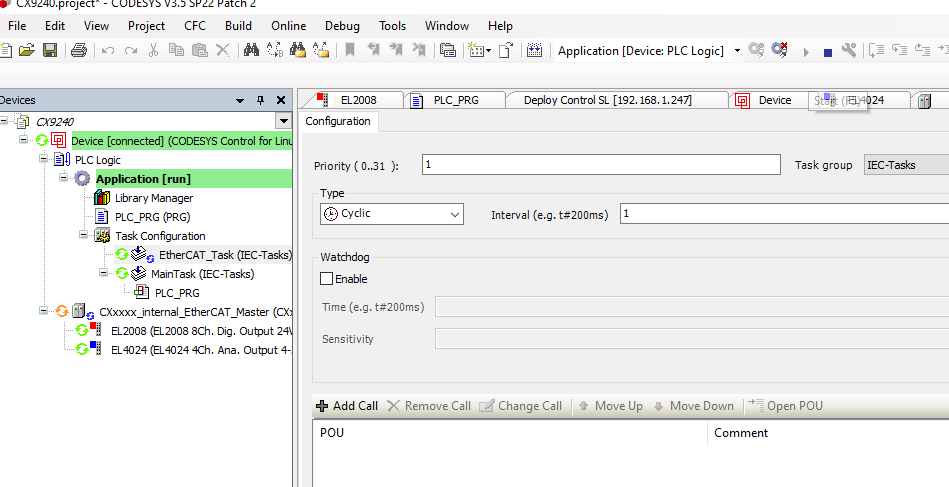
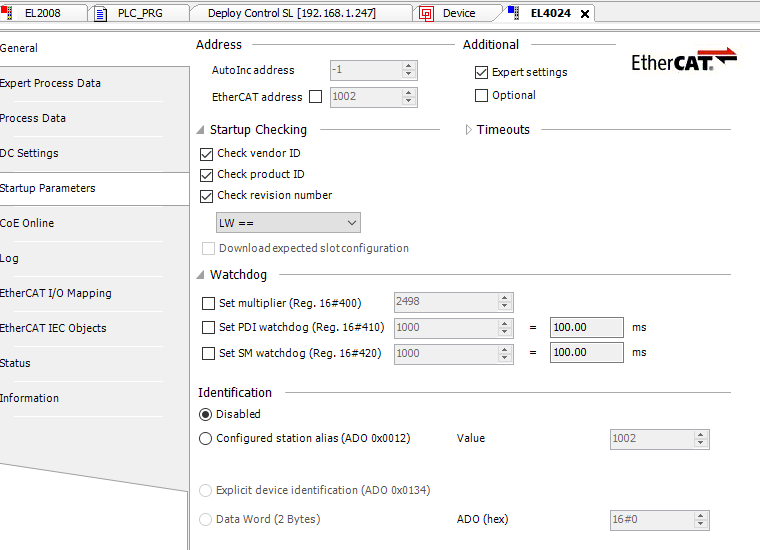
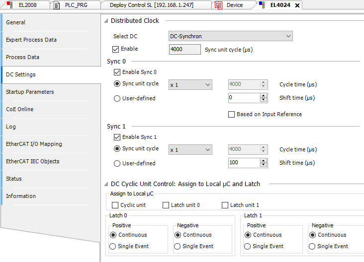
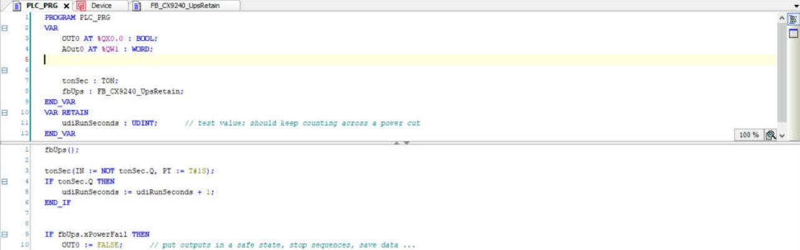

# CX9240 with CODESYS: setup guide

Nov 21, 2026

## Overview

This guide takes a Beckhoff CX9240 from a blank state to a controller that runs **CODESYS Control for Linux** on its internal EtherCAT bus, with no TwinCAT runtime. It follows the order that was actually used on the bench controller.

When you finish, the controller has:

- **Beckhoff RT Linux** (Debian 13) as its operating system.
- **The internal EtherCAT master as a Linux network interface, `eth0`.** CODESYS uses it like any other EtherCAT adapter. The E-bus terminals plugged into the CX9240 appear in a CODESYS scan.
- **A power-fail signal from the internal UPS**, readable from a CODESYS program, with a function block that saves RETAIN data when the supply is lost.
- **The TC front LED showing CODESYS state**: green while the runtime is cycling the bus, red when it is stopped.

Everything specific to the CX9240 comes from one package, `ccat-cx9240-dkms_1.0-7_all.deb`. The rest is standard Beckhoff and CODESYS software.

> **Status of this work.** The driver is a bench project, not a Beckhoff or CODESYS product. It was developed and tested on one CX9240 with an EL2008 and an EL4024. The EtherCAT part is built on Beckhoff's open-source CCAT driver plus register settings found by experiment. Read the last section, *Known limits*, before relying on it.

Steps the author of this guide did not perform or watch are marked **not verified here**. Those are the image download, the Rufus step, the installation onto the controller, and the CODESYS runtime deployment; they were done by hand at the bench, and the guide describes them from Beckhoff's and CODESYS's published procedures.

## 1. What you need

### Hardware

- Beckhoff **CX9240** with its 24 V supply. Wire both the system supply and the field (power contact) supply; analog and digital output terminals do nothing without the field supply.
- One or more **E-bus terminals** on the CX9240. Tested: EL2008 (8 digital outputs) and EL4024 (4 analog outputs, 4–20 mA).
- A **microSD card** for the controller. The tested card is 16 GB. This card is the controller's disk: the image is written straight onto it.
- A **microSD card reader** on the PC.
- An Ethernet connection between the PC and the controller's RJ45 port, on a network with DHCP.

### Accounts

- A **myBeckhoff account**. It is needed twice: to download the image, and on the controller so that `apt` can download packages from Beckhoff's servers.
- A **CODESYS Store account**, to download the CODESYS Development System and the *CODESYS Control for Linux ARM64 SL* add-on.

### Software on the Windows PC

| Software | Used for | Version tested |
| --- | --- | --- |
| Rufus | Writing the image to the microSD card | 4.6 portable |
| CODESYS Development System | Programming, and deploying the runtime | V3.5 SP22 Patch 2 |
| CODESYS Control for Linux ARM64 SL add-on | The runtime that is deployed to the controller | 4.21.0.0 |
| CODESYS EtherCAT | EtherCAT master in the project | 4.11.0.0 |
| OpenSSH client | Copying files to and logging in to the controller | Built into Windows 10 and 11 |
| TwinCAT 3 (optional) | Source of Beckhoff terminal description files | Any |

### Files

- **The Beckhoff RT Linux image for the CX9240.** Tested build: `Beckhoff-RT-Linux-440542-cx9240-arm64.img`, 1.5 GB.
- **The driver package**, `ccat-cx9240-dkms_1.0-7_all.deb`, from the `packaging` folder of the project.
- **The function block** `FB_CX9240_UpsRetain.st`, which combines the UPS signal and the RETAIN save in one block. It is in the project's `ups_test` folder, and the package also installs a copy on the controller under `/usr/share/doc/ccat-cx9240-dkms/examples/`.

> The CODESYS runtime runs in **demo mode** without a licence: fully functional, but it stops after about two hours and has to be restarted. That is how it was used for all the testing described here.

## 2. Download the Beckhoff RT Linux image

*Not verified here: this step was done by hand. The link and file names below come from Beckhoff's documentation and from the files in the Downloads folder of the PC that was used.*

1. Open Beckhoff's Download Finder entry for the CX9240 image: [Beckhoff RT Linux (for CX9240)](https://www.beckhoff.com/en-en/support/download-finder/search-result/?download_group=829549649). Beckhoff's instructions for Arm devices link to this entry from [Installation on Arm-based systems](https://infosys.beckhoff.com/content/1033/beckhoff_rt_linux/18419873419.html).
2. Sign in with your myBeckhoff account when asked.
3. Download the newest CX9240 image. Take care to pick the **CX9240** entry: there is a separate image for CX82x0 devices and a separate installer for x64 PCs, and neither works on a CX9240.
4. Unpack the download. You get a folder like this:

*Beckhoff's Download Finder entry as it looked on 21 November 2026: version 13, build 440542, a 446 MB ZIP, marked "Login required". Click the ZIP link after signing in.*

| File | Purpose |
| --- | --- |
| `Beckhoff-RT-Linux-440542-cx9240-arm64.img` | The disk image to write to the microSD card (1.5 GB) |
| `Beckhoff-RT-Linux-440542-cx9240-arm64.img.sha256` | Checksum of the image |
| `Readme.txt` | Beckhoff's licence note and a link to the manual |
| `FactoryImage` folder | Boot files; not needed for this procedure |

The number in the name (`440542`) is the build. Newer builds will have a higher number.

### Check the download

A damaged image produces a controller that fails in confusing ways, so compare the checksum before writing it. In PowerShell, in the unpacked folder:

```
Get-FileHash .\Beckhoff-RT-Linux-440542-cx9240-arm64.img -Algorithm SHA256
Get-Content .\Beckhoff-RT-Linux-440542-cx9240-arm64.img.sha256
```

The two long hexadecimal values must match (upper or lower case does not matter).

> **Licence.** Beckhoff's Readme states that the software without a separate commercial licence is for testing only.

## 3. Write the image to the microSD card with Rufus

*Not verified here: this step was done by hand. The procedure is Beckhoff's; the details of what Rufus reports come from the Rufus log of the flash that produced the tested controller.*

On the CX9240 there is no separate installer. The image **is** the system disk: Rufus copies it onto the microSD card, and the controller boots from that card. The Readme in the download mentions a "USB stick"; that applies to x64 PCs. For the CX9240, Beckhoff's instructions say to write the image directly to the microSD card.

> **This erases the card.** Everything on the microSD card is destroyed, including any earlier controller installation, CODESYS project and retain data.

1. Power the controller off and remove its microSD card. Put the card in the PC's card reader.
2. Download Rufus from [rufus.ie](https://rufus.ie/) and start it. The portable version needs no installation. Windows asks for administrator permission; Rufus needs it to write to the card.
3. Under **Device**, select the microSD card. In the tested setup it appeared as `mSD Card`, 16 GB. Check the size carefully so that you do not pick another drive.
4. Next to **Boot selection**, click **SELECT** and choose the `.img` file from step 2.
5. Leave the other settings alone. Rufus recognises the file as a bootable disk image and writes it sector by sector; the partition and file system options do not apply and are greyed out.
6. Click **START** and confirm the warning that all data on the card will be destroyed.
7. Wait for the status bar to show **READY**. Beckhoff's instructions say not to cancel before that. It takes a few minutes for the 1.5 GB image.
8. Close Rufus, eject the card in Windows, and remove it.


*Rufus 4.6 (portable) ready to write: the 16 GB microSD card under **Device**, the CX9240 image under **Boot selection**, and **START** available. The partition and file system options stay greyed out for a disk image; the values shown in them are what Rufus read from the card and do not matter.*

> **Watch the download page.** When this guide was written, the Rufus website showed advertisements with large "Download" buttons that are not Rufus. Use the links in the page's own *Download* section, which list files named `rufus-<version>.exe` and `rufus-<version>p.exe` (portable).

If Windows offers to format the card afterwards, decline. The card now holds Linux partitions that Windows cannot read, which is expected.

## 4. First boot and login

*Not verified here: inserting the card and the first boot were done by hand. The checks at the end of this section were run on the tested controller.*

1. With the controller powered off, insert the microSD card.
2. Connect an Ethernet cable from one of the controller's RJ45 ports to your network.
3. Switch on the 24 V supply and wait about a minute for the first boot.

### Find the controller's address

The image uses DHCP. Look up the address in your router's or DHCP server's client list. The tested controller announced itself with a host name beginning `BTN-`. In the examples below the address is `192.168.1.247`; use your own.

### Log in over SSH

From a Command Prompt or PowerShell window on the PC:

```
ssh Administrator@192.168.1.247
```

Accept the host key on the first connection, then enter the password of the `Administrator` user. Use the initial password given in Beckhoff's documentation for the image, and change it with `passwd` once you are in.

If SSH refuses to connect with a warning that the host key has changed, the PC remembers an earlier installation at the same address. Remove the old entry and try again:

```
ssh-keygen -R 192.168.1.247
```

### Check the system

Run these on the controller. The values shown are from the tested image.

```
uname -r            # 7.2.13-rt5-bhf-436945-52e30b343116
ip -br link         # lo, end0, end1   (no eth0 yet)
df -h /             # about 14 GB on a 16 GB card
```

Two things to notice on a fresh image:

- The built-in network ports are called `end0` and `end1`. There is no `eth0` yet; the driver package creates it.
- The image has no compiler, no kernel headers and no TwinCAT or CODESYS runtime. The next two steps bring in what is needed.

> **Password prompts in this guide.** Commands starting with `sudo` ask for the Administrator password. Type it yourself each time; do not put it in scripts.

## 5. Give apt access to Beckhoff's package servers

A freshly flashed image cannot download any packages. All of its package sources point at Beckhoff servers, and they answer `401 Unauthorized` until the controller has your myBeckhoff login. On the tested controller, `sudo apt update` failed in exactly this way until the file below was created.

1. On the controller, create the credentials file:

```
sudo nano /etc/apt/auth.conf.d/bhf.conf
```

2. Enter these lines, with your myBeckhoff e-mail address and password in place of the examples. This is the layout from Beckhoff's documentation:

```
machine deb.beckhoff.com
login example@mail.com
password xyz123

machine deb-mirror.beckhoff.com
login example@mail.com
password xyz123
```

3. Save with **Ctrl+O**, **Enter**, and leave the editor with **Ctrl+X**.
4. Restrict the file to root, since it contains your password:

```
sudo chmod 600 /etc/apt/auth.conf.d/bhf.conf
```

5. Refresh the package lists:

```
sudo apt update
```

The output should end with `Reading package lists... Done` and no lines starting with `E:`. If you still see `401 Unauthorized`, the e-mail address or password in the file is wrong.

Beckhoff's own description of this step is at [Authenticate on the Beckhoff Package Server](https://infosys.beckhoff.com/content/1033/beckhoff_rt_linux/17350409995.html).

> **Do not install the TwinCAT runtime.** The driver package conflicts with `tc31-xar-um`, because TwinCAT and this driver cannot both own the internal EtherCAT master. `apt` refuses to install one while the other is present.

## 6. Install the driver package

One package brings in everything that is specific to the CX9240.

1. On the PC, open a Command Prompt in the folder that holds the package and copy it to the controller:

```
scp ccat-cx9240-dkms_1.0-7_all.deb Administrator@192.168.1.247:
```

2. On the controller, install it:

```
sudo apt install ./ccat-cx9240-dkms_1.0-7_all.deb
```

The `./` matters: it tells `apt` to install the local file and fetch whatever it depends on. On a fresh image that is about 100 packages (compiler, kernel headers, DKMS) and takes a few minutes. The driver is then compiled on the controller for its running kernel.

### What the package installs

| Part | What it does |
| --- | --- |
| Kernel modules `ccat`, `ccat_netdev`, `ccat_cx_shim` | Make the internal EtherCAT master a network interface, `eth0` |
| Kernel module `ccat_tcled` | Makes the TC front LED three standard Linux LEDs: `red:tc`, `green:tc`, `blue:tc` |
| `ccat-ecat.service` | Loads the driver and brings `eth0` up at every boot, before CODESYS starts |
| Network rule for `eth0` | Keeps DHCP and other network services off the EtherCAT bus |
| `ccat-ups-codesys` watch | Adds the UPS path entry to the CODESYS configuration, now or when CODESYS is installed later |
| `codesys-tcled.service` | Sets the TC LED green or red from CODESYS bus activity |
| Examples and notes in `/usr/share/doc/ccat-cx9240-dkms/` | The two function blocks, test programs, UPS measurements |

Because the modules are built with DKMS, they are rebuilt automatically when a kernel update is installed. That rebuild has not been tested.

### Check the result

```
sudo dkms status              # ccat-cx9240/1.0, <kernel>, aarch64: installed
systemctl is-active ccat-ecat # active
ip -br link show eth0         # eth0  UP ... LOWER_UP
ls /sys/class/leds            # includes red:tc green:tc blue:tc
```

`eth0` shows `LOWER_UP` only when at least one terminal is plugged into the controller. At this point the TC LED is **red**, because CODESYS is not running yet.

### Optional: test the bus without CODESYS

The package includes a small stand-alone EtherCAT test. It takes one EL2008 through to the operational state and switches output 1 on for five seconds:

```
cp /usr/share/doc/ccat-cx9240-dkms/examples/ecat_op.c ~ && cd ~
gcc -O2 -o ecat_op ecat_op.c
sudo ./ecat_op eth0 5 01
```

On the freshly flashed test controller this reported 2,500 cyclic frames with none lost. Run it only while CODESYS is not using the bus, and only with an EL2008 as the first terminal.

## 7. Deploy the CODESYS runtime from the IDE

*Not verified here: this step was done by hand in the IDE. The procedure below is from the CODESYS online help for the Deploy Tool; the result on the controller was checked afterwards.*

The CODESYS Development System installs the runtime onto the controller over SSH. Nothing has to be downloaded on the controller itself.

### Prepare the IDE

1. Install the CODESYS Development System on the PC.
2. Install the add-on **CODESYS Control for Linux ARM64 SL** from the CODESYS Store, using the CODESYS Installer (**Tools → CODESYS Installer**, then *Browse* or *Install File*). The CX9240 has a 64-bit Arm processor, so the **ARM64** product is the right one; the plain "Linux SL" product is for x64 PCs and the "ARM SL" product is for 32-bit Arm.
3. Restart CODESYS so that the add-on's menu entry appears.

### Connect to the controller

1. In CODESYS, click **Tools → Deploy Control SL**. A *Deploy Control SL* tab opens.
2. On the **Communication** tab, enter the controller's IP address, or click **Scan** to list devices on the network. Leave the port at 22.
3. Enter the user name `Administrator` and its password, and connect.

### Install the runtime

1. Open the **Deployment** tab.
2. In the **Product** list, select **CODESYS Control for Linux ARM64 SL**.
3. In the **Version** list, select the version. The tested version is **4.21.0.0**.
4. Click **Install**.


*The Deploy Control SL tab with its three pages: Communication, Deployment and Operation. This capture was taken while disconnected, so the Product and Version lists are empty; they fill in once you connect on the Communication page.*

The IDE copies the packages to the controller and installs them. According to the CODESYS help the controller's runtime is started automatically afterwards; no manual restart is needed.

### Check on the controller

```
systemctl is-active codesyscontrol   # active
```

On the tested controller the deployment had installed four packages: `codesyscontrol` (the runtime), `codesysedge` (the gateway), `codesysproxy` and `codemeter-lite` (licensing).

When the runtime's configuration file appears, the driver package notices, adds its UPS entry to it and restarts the runtime once. This is automatic. You can confirm it with:

```
sudo tail -3 /etc/codesyscontrol/CODESYSControl_User.cfg
```

The last lines should be:

```
[SysFile]
PlaceholderFilePath.1=/sys/class/power_supply/ups, $ups$
```

That automatic step worked when CODESYS was installed by the setup script on a fresh image; for a deployment from the IDE it has only been simulated. If the lines are missing, add them with `sudo /usr/lib/ccat-cx9240/codesys-ups-setup.sh add`.

> **Order matters a little.** If you deploy CODESYS *before* installing the driver package, the runtime starts when `eth0` does not exist yet. Restart it once after installing the driver: `sudo systemctl restart codesyscontrol`.

CODESYS references: [Establishing a Connection](https://content.helpme-codesys.com/en/CODESYS%20Control/_rtsl_establish_connection_linux.html) and [Installing the runtime on the controller](https://content.helpme-codesys.com/en/CODESYS%20Control/_rtsl_install_runtime_on_controller.html).

## 8. Open the controller's firewall for CODESYS

The image's firewall drops all incoming traffic except SSH and Beckhoff's own services. With the runtime installed and running, the CODESYS IDE still cannot find or connect to it until three port ranges are opened. On the tested controller this was the reason for "cannot connect to the runtime" after a clean install.

1. On the controller, create a new rule file:

```
sudo nano /etc/nftables.conf.d/60-codesys.conf
```

2. Enter:

```
table inet filter {
  chain input {
    # CODESYS runtime, gateway and network scan
    tcp dport { 1217, 11740 } accept
    udp dport 1740-1743 accept
  }
}
```

3. Save (**Ctrl+O**, **Enter**, **Ctrl+X**) and load the rule:

```
sudo systemctl reload nftables
```

4. Confirm it is active:

```
sudo nft list chain inet filter input | grep 11740
```

The command should print the `tcp dport { 1217, 11740 } accept` line.

| Port | Used by |
| --- | --- |
| TCP 11740 | The runtime's connection from the IDE |
| TCP 1217 | The CODESYS gateway on the controller |
| UDP 1740–1743 | The network scan that finds the controller |

The rule survives a reboot; the tested controller was power-cycled several times after it was added and CODESYS kept connecting.

> **Security.** This opens the programming ports to every device that can reach the controller. That is normal for a bench, and a reason to keep the controller off untrusted networks. The firewall rule is deliberately not part of the driver package.

## 9. CODESYS project: connect, add the EtherCAT master, scan the terminals

This section was worked through on the tested controller. The order of the steps matters in two places, both marked below.

### Create the project and connect

1. In CODESYS, create a **Standard project**. As the device, choose **CODESYS Control for Linux ARM64 SL**; as the language for `PLC_PRG`, Structured Text.
2. Double-click **Device** in the device tree and open **Communication Settings**.
3. Click **Scan Network** and select the controller, or type its IP address into the device field and press Enter.
4. On the first connection to a new runtime, CODESYS asks for two things:
   - **Create a user.** The runtime has no accounts yet. Choose a user name and password; you need them at every login from now on.
   - **Trust the certificate.** The runtime generated a new key when it first started. Accept it.

### Install the terminal descriptions

CODESYS needs a description file (ESI, an XML file) for every terminal type, otherwise a scan reports *"The device was not found in the repository"* with only a vendor and product code.

1. Get Beckhoff's description files. If TwinCAT 3 is installed on the PC, they are in `C:\TwinCAT\3.1\Config\Io\EtherCAT\`, one file per terminal family: `Beckhoff EL2xxx.xml` for digital outputs, `Beckhoff EL4xxx.xml` for analog outputs, and so on. They can also be downloaded from Beckhoff's website.
2. In CODESYS, open **Tools → Device Repository**, click **Install**, and select the files for the terminal families you use.

### Add the EtherCAT master

1. Right-click **Device** → **Add Device**, and under **Fieldbuses → EtherCAT → Master** add an EtherCAT master. In the tested project the entry used was the one shown in the tree as `CXxxxx_internal_EtherCAT_Master`.
2. Double-click the master and open its **General** tab.
3. Under **EtherCAT NIC Settings**, click **Select...** and choose the adapter named `eth0` from the list the controller reports. The IDE must already have its connection to the controller set up (previous section) for that list to appear. CODESYS fills in the network name and the source MAC address; on the tested controller that was `00-01-05-B5-76-30`, and yours will differ.


*The master's General tab on the tested project, online: network name `eth0`, and the Distributed Clock cycle time used in step 10.*

Adding the master also creates a task named `EtherCAT_Task`.

### Download once, then scan

**Order matters here.** The scan uses the EtherCAT stack running on the controller, so the project with the master has to be on the controller first. Scanning straight away fails with *"Device scan not possible: The stack is not available. Please login first."*

1. Build the project and **log in** (Online → Login). Accept the download.
2. **Start** the application.
3. Right-click the EtherCAT master → **Scan for Devices**.
4. The dialog lists the terminals in the order they are plugged in. Click **Copy All Devices to Project**.
5. Log out, then log in again to download the project with the terminals in it, and start it.


*The Scan Devices dialog with both test terminals found and identified.*

When it is running, the master and every terminal show a green symbol in the device tree, and the master's General tab reports *"Startup finished: All slaves in operational!"*. On the controller the TC LED turns green.


*The device tree with the application running: master and both terminals green.*

### Use the outputs

The scan gives every terminal an **EtherCAT I/O Mapping** tab that shows the address of each channel. Declare variables at those addresses, or type variable names into the mapping tab. The tested program was:

```
PROGRAM PLC_PRG
VAR
    OUT0  AT %QX0.0 : BOOL;   // EL2008 output 1
    AOut0 AT %QW1   : WORD;   // EL4024 channel 1
    AOut1 AT %QW2   : WORD;
END_VAR

OUT0  := TRUE;
AOut0 := 32000;   // about 19.6 mA
AOut1 := 16000;   // about 11.8 mA
```


*The test program online. `AOut2` is set to 65000 here, which is outside the EL4024's range and gives the minimum current.*

Check the addresses against your own mapping tab rather than copying these. For the EL4024 the value range is 0 to 32767 for 4 to 20 mA; a value above 32767 is read as negative and gives the minimum current.

> **If an analog or digital output stays dead** while everything is green in CODESYS, check the field power supply wiring first. On the test bench the EL4024 gave no current until the missing power-contact supply was wired.

## 10. Cycle time and distributed clocks

The default bus cycle is 4 ms. The driver was also tested at 1 ms and at 500 µs.

### Change the cycle time

Set the cycle time on the **EtherCAT master**, not on the task.

1. Log out.
2. Open the EtherCAT master's **General** tab. Under **Distributed Clock**, set **Cycle time** in microseconds, for example `1000` for 1 ms.
3. Check that `EtherCAT_Task` in the Task Configuration now shows the same interval.
4. Log in, accept the download, and start.


*The `EtherCAT_Task` configuration. Its interval follows the master's cycle time; changing it here alone did not change the bus.*

Typing a new interval into `EtherCAT_Task` alone did not change the bus on the tested system: the frames kept going out every 4 ms until the master's cycle time was changed. No change to the runtime's configuration on the controller is needed for 1 ms.

### Turn on distributed clocks

Distributed clocks (DC) need a terminal that supports them. The EL4024 does; the EL2008 does not.

1. Open the terminal, tick **Expert settings** on its **General** tab, then open its **DC Settings** tab.
2. Under **Select DC**, choose **DC-Synchron** and tick **Enable**. Sync 0 and Sync 1 enable themselves with the master's cycle time. Leave the defaults.
3. On the master's **General** tab, tick **Sync window monitoring**.
4. Download and start.


*EL4024 General tab with Expert settings ticked, which makes the DC Settings tab available.*


*EL4024 DC Settings: DC-Synchron selected and enabled, shown here at the default 4000 µs cycle.*

A DC terminal that goes green and stays green is the practical sign that frames are arriving regularly enough.

### What was measured

With the EL4024 in DC-Synchron mode as the reference clock, frame arrival was timed by the terminal's own hardware clock, read passively from the bus.

| Cycle time | Frames measured | Shortest / longest interval | Intervals off by more than 100 µs | Missed cycles |
| --- | --- | --- | --- | --- |
| 4 ms | 15,000 | 3.874 ms / 4.152 ms | 17 | 0 |
| 1 ms | 60,000 | 0.906 ms / 1.059 ms | 0 | 0 |
| 500 µs, run 1 | 120,000 | 0.446 ms / 13.5 ms | 1 | 1 gap of about 26 cycles |
| 500 µs, run 2 | 360,000 | 0.446 ms / 0.555 ms | 0 | 0 |

In every run both terminals stayed operational and the interface reported zero errors.

Read the 500 µs rows with care. One run had a single 13.5 ms gap whose cause was never found; a second, longer run was clean. Treat 500 µs as working but not proven free of stalls, and 1 ms as the fastest setting with a clean record.

Only one DC terminal was on the bus, and it was the reference clock, so the deviation *between* DC terminals was never measured.

## 11. UPS: power-fail signal and saving RETAIN data

The CX9240 has a small internal UPS, a capacitor that keeps the processor running for a short time after the supply is lost. Beckhoff calls this class a "1-second UPS". Linux already exposes it; the driver package only makes it reachable from a CODESYS program.

### What the UPS can and cannot do

Measured on the tested controller, by pulling the 24 V supply with CODESYS running:

| Event | Time after the power-fail signal |
| --- | --- |
| Signal changes from `Charging` to `Not charging` | 0 |
| PLC program reacts (1 ms task) | 0.5 ms |
| E-bus terminals stop answering | about 5 ms |
| RETAIN data saved and forced to disk (4 KB) | about 0.1 s |
| Controller stops | 5.9 to 6.4 s |

Three consequences:

- **The terminals are not backed up.** They lose power about 5 ms after the signal, so the program cannot drive outputs to a safe state. The outputs simply drop.
- **There is plenty of time to save data.** A save takes a tenth of a second.
- **Design for one second, not six.** The measured hold-up is from one new unit at room temperature; Beckhoff's rating for this UPS class is one second over the life of the product.

A separate lesson from the tests: hold-up time does not save files by itself. A file written 40 seconds before a power cut, and never explicitly forced to disk, came back empty. The function block below forces its file to disk for that reason.

### Controller side

Nothing to do. The driver package added this entry to the runtime's configuration in step 7, which lets a program open the UPS status file under the name `$ups$`:

```
[SysFile]
PlaceholderFilePath.1=/sys/class/power_supply/ups, $ups$
```

### Project side

1. In the **Library Manager**, add the libraries **SysFile** and **CmpApp**.
2. Add a function block (right-click **Application → Add Object → POU**, type *Function block*, language *Structured Text*) named `FB_CX9240_UpsRetain`. Paste the part from `FUNCTION_BLOCK` to the last `END_VAR` into the upper (declaration) pane, replacing what is there, and the rest into the lower (implementation) pane. The same text is in the project file `ups_test/FB_CX9240_UpsRetain.st`.

This one block reads the power-fail signal and saves the RETAIN data. It replaces the two separate blocks `FB_CX9240_Ups` and `FB_CX9240_RetainSave` used in earlier versions of this guide.

```
FUNCTION_BLOCK FB_CX9240_UpsRetain
VAR_INPUT
    xSaveOnPowerFail : BOOL := TRUE;  (* save the RETAIN data when power fails *)
    xSaveRequest     : BOOL;          (* optional: save on rising edge *)
    sTmpFile : STRING := 'Application/Application.tmp';   (* change if the application *)
    sRetFile : STRING := 'Application/Application.ret';   (* is not named "Application" *)
END_VAR
VAR_OUTPUT
    (* power-fail signal *)
    xPowerFail      : BOOL;       (* TRUE = supply lost, running from the UPS capacitor *)
    xValid          : BOOL;       (* TRUE = status file was read successfully this cycle *)
    sStatus         : STRING(31); (* raw text from the kernel: "Charging" / "Not charging" *)
    udiReadErrors   : UDINT;      (* number of failed reads since start *)
    (* retain save *)
    xSaveDone       : BOOL;       (* at least one save has completed since start *)
    udiSaveCount    : UDINT;      (* number of saves since start *)
    tSaveDuration   : TIME;       (* how long the last save took *)
    udiStoreResult  : UDINT;      (* 0 = OK, storing the retains *)
    udiFlush1Result : UDINT;      (* 0 = OK, forcing the data to disk *)
    udiRenameResult : UDINT;      (* 0 = OK *)
    udiFlush2Result : UDINT;      (* 0 = OK, forcing the rename to disk *)
END_VAR
VAR
    hStatus   : POINTER TO BYTE;
    xOpen     : BOOL;
    abyBuf    : ARRAY[0..31] OF BYTE;
    nRead     : __XWORD;
    i         : INT;
    pApp      : POINTER TO CmpApp.APPLICATION;
    hFile     : POINTER TO BYTE;
    xPrevFail : BOOL;
    xPrevReq  : BOOL;
    xDoSave   : BOOL;
    tStart    : TIME;
    res       : UDINT;
END_VAR
```

```
(* ---------- 1. read the UPS status ---------- *)
IF NOT xOpen THEN
    (* '$$' is a literal dollar sign in an IEC string: the path sent is $ups$/status *)
    hStatus := SysFileOpen('$$ups$$/status', ACCESS_MODE.AM_READ, ADR(res));
    xOpen := (res = 0);
END_IF

xValid := FALSE;
IF xOpen THEN
    SysFileSetPos(hStatus, 0);
    nRead := SysFileRead(hStatus, ADR(abyBuf), SIZEOF(abyBuf) - 1, ADR(res));
    IF nRead > 0 THEN
        xValid := TRUE;
        (* 'N' (16#4E) is the first letter of "Not charging" *)
        xPowerFail := (abyBuf[0] = 16#4E);
        sStatus := '';
        FOR i := 0 TO TO_INT(nRead) - 1 DO
            IF abyBuf[i] < 16#20 THEN EXIT; END_IF
            sStatus[i] := abyBuf[i];
            sStatus[i + 1] := 0;
        END_FOR
    ELSE
        udiReadErrors := udiReadErrors + 1;
        SysFileClose(hStatus);
        xOpen := FALSE;
    END_IF
ELSE
    udiReadErrors := udiReadErrors + 1;
END_IF

(* ---------- 2. save the RETAIN data on power fail or on request ---------- *)
IF pApp = 0 THEN
    pApp := AppGetCurrent(ADR(res));
END_IF

xDoSave := (xSaveOnPowerFail AND xPowerFail AND NOT xPrevFail)
        OR (xSaveRequest AND NOT xPrevReq);

IF xDoSave AND pApp <> 0 THEN
    tStart := TIME();

    udiStoreResult := AppStoreRetainsInFile(pApp, sTmpFile);

    hFile := SysFileOpen(sTmpFile, ACCESS_MODE.AM_READ_PLUS, ADR(res));
    IF res = 0 THEN
        udiFlush1Result := SysFileFlush(hFile);
        SysFileClose(hFile);
    ELSE
        udiFlush1Result := res;
    END_IF

    IF udiStoreResult = 0 THEN
        (* the rename does not replace an existing file, so remove the old one first *)
        SysFileDelete(sRetFile);
        udiRenameResult := SysFileRename(sTmpFile, sRetFile);
        hFile := SysFileOpen(sRetFile, ACCESS_MODE.AM_READ_PLUS, ADR(res));
        IF res = 0 THEN
            udiFlush2Result := SysFileFlush(hFile);
            SysFileClose(hFile);
        ELSE
            udiFlush2Result := res;
        END_IF
    END_IF

    tSaveDuration := TIME() - tStart;
    udiSaveCount := udiSaveCount + 1;
    xSaveDone := TRUE;
END_IF
xPrevFail := xPowerFail;
xPrevReq  := xSaveRequest;
```

3. In `PLC_PRG`, declare one instance and the data to keep, and call the block every cycle:

```
VAR
    fbUps : FB_CX9240_UpsRetain;
END_VAR
VAR RETAIN
    udiRunSeconds : UDINT;      // example of a value that must survive a power cut
END_VAR

fbUps();
// fbUps.xPowerFail is available for your own logic
```

4. Call it from a **fast task**. The block reads the signal once per call, so a 1 ms task reacts within 1 ms. In the default 20 ms `MainTask` it reacts within 20 ms, which is still early enough to save data.

The save on power fail is switched on by default. Set the input `xSaveOnPowerFail := FALSE` to use only the signal, and pulse `xSaveRequest` to save at any other time.


*`PLC_PRG` with the combined block: one instance, `fbUps : FB_CX9240_UpsRetain`, and one call, `fbUps();`. The counter under `VAR RETAIN` is the test value. The reaction on `OUT0` at the bottom is only a test aid: the terminals lose power about 5 ms after the signal.*

### How saving and restoring fit together

- **Saving** is done by the function block: it writes the RETAIN variables to a temporary file, forces it to disk, swaps it in as `Application/Application.ret`, and forces that to disk.
- **Restoring** is done by the runtime. At start it loads `Application.ret` if it exists and logs *"Retains matched to bootproject"*. No code is needed.
- The runtime does **not** write that file by itself, neither on power loss nor on a clean restart. Values on disk are therefore as of the last save. Before a commanded restart or reboot, pulse `xSaveRequest` to save the current values.
- A project **download** normally clears RETAIN data.

### Check it

Online, `fbUps.xValid` should be TRUE and `fbUps.sStatus` should read `Charging`. To test the whole chain, let the example counter run, note its value, unplug the 24 V supply for ten seconds, and plug it back in. After the controller boots, the counter should continue from about the noted value instead of starting at zero. This was confirmed on the tested controller.

## 12. TC LED: run and stop indication

The LED labelled **TC** on the front of the CX9240 is driven by the controller's FPGA, not by an ordinary Linux GPIO, so Linux does not know about it on a fresh image. The driver package adds it and uses it to show the CODESYS state. There is nothing to configure.

| TC LED | Meaning |
| --- | --- |
| Green | The CODESYS runtime is sending EtherCAT frames: the application is running |
| Red | No frames for 1.5 seconds: the application is stopped, no application is loaded, or the runtime is not running |

At power-up the LED is red until CODESYS has started its boot application and begins cycling the bus. On the tested controller that took about 16 seconds from the start of the LED service.

### How it works, and its limits

A small service checks twice a second whether frames are leaving `eth0`. This needs no code in the PLC project. It also means the LED follows **bus activity**, not the application state as such:

- A project with no EtherCAT master on `eth0` always shows red.
- If the bus stops for some other reason while the program keeps running, the LED goes red.

Green and red were confirmed by eye, including the change when the application is stopped and started from the IDE.

### Use the LED for something else

The LED appears as three ordinary Linux LEDs. Switch the status service off, then write `1` or `0` to the one you want:

```
sudo systemctl disable --now codesys-tcled
echo 1 | sudo tee /sys/class/leds/blue:tc/brightness
```

The names are `red:tc`, `green:tc` and `blue:tc`. Red and green are confirmed; blue is assumed from the order of the bits in the register and has not been looked at.

To turn the status display back on: `sudo systemctl enable --now codesys-tcled`.

## 13. Final checks and troubleshooting

### A healthy controller

Run these on the controller with the application running.

| Check | Command | Expected |
| --- | --- | --- |
| Driver built | `sudo dkms status` | `ccat-cx9240/1.0, ..., aarch64: installed` |
| Services | `systemctl is-active ccat-ecat codesys-tcled codesyscontrol` | `active` three times |
| Bus interface | `ip -br link show eth0` | `UP` and `LOWER_UP` |
| Frames and errors | `ip -s link show eth0` | RX and TX packet counts equal and rising, errors 0 |
| UPS signal | `cat /sys/class/power_supply/ups/status` | `Charging` |
| Runtime log | `sudo tail /var/opt/codesys/codesyscontrol.log` | `Startup finished: All slaves in operational !` |
| TC LED | Look at the controller | Green |

Then reboot once (`sudo systemctl reboot`) and confirm that the bus, the application and the green LED come back without help.

### Problems that actually came up

| Symptom | Cause | Fix |
| --- | --- | --- |
| `apt` reports `401 Unauthorized` | No myBeckhoff login on the controller | Step 5 |
| Package install fails: kernel headers "cannot be found" | An old package version (1.0) that did not depend on the headers | Use 1.0-2 or later |
| CODESYS cannot find or connect to the controller | Firewall | Step 8 |
| Scan: "The stack is not available. Please login first" | Project with the master not yet downloaded and running | Step 9, *Download once, then scan* |
| Scan: "The device was not found in the repository" | Terminal description file not installed | Step 9, *Install the terminal descriptions* |
| The EtherCAT master does not start after the driver was installed or reloaded | Runtime started before `eth0` existed | `sudo systemctl restart codesyscontrol` |
| Everything green, but an output terminal does nothing | Field power supply not wired | Wire the power-contact supply |
| Analog output stuck at minimum | Value above 32767 | Use 0 to 32767 |
| Cycle time does not change | Changed on the task instead of the master | Step 10 |
| Function block will not compile: unknown `RTS_IEC_HANDLE`, `RTS_IEC_RESULT` or `RTS_INVALID_HANDLE` | An early draft of the block | Use the text in step 11 |
| `fbUps.xValid` stays FALSE | UPS path entry missing from the runtime configuration | `sudo /usr/lib/ccat-cx9240/codesys-ups-setup.sh add` |
| RETAIN values come back old after a power cut | An early draft of the save block that could not replace an existing file | Use the text in step 11 |
| TC LED stays red while the program runs | No EtherCAT master on `eth0` in the project, or the bus is stopped | See step 12 |
| The application stops after about two hours | Runtime demo mode, no licence | Restart the runtime, or license it |

### Useful commands

```
sudo journalctl -u ccat-ecat -b        # driver start-up messages
sudo journalctl -u codesys-tcled -b    # LED state changes with times
sudo dmesg | grep -i ccat              # kernel messages from the driver
sudo systemctl restart codesyscontrol  # restart the CODESYS runtime
```

### Remove everything again

```
sudo apt remove ccat-cx9240-dkms
```

This unloads the driver, removes its services and takes the UPS entry out of the CODESYS configuration. `eth0` disappears, so stop CODESYS first.

## 14. Known limits and what was not tested

### What the testing covered

- **One controller.** A single CX9240 (FPGA build 2026-07-02), image build 440542, kernel `7.2.13-rt5-bhf-436945-52e30b343116`.
- **Two terminals.** One EL2008 and one EL4024.
- **A clean-image install of package 1.0-2.** The controller was reflashed and the package, CODESYS and the firewall rule were installed from scratch; CODESYS then ran both terminals.
- **Upgrades to 1.0-3 and 1.0-4 on that same controller**, each followed by a reboot.
- **Seven supply pulls** for the UPS work, including one failed attempt that led to the fix in the save block.

### Not tested

- **Package 1.0-7 on a controller.** It differs from 1.0-5 only in its README and in licence header comments. Version 1.0-4 was installed on a freshly flashed controller by the setup script, and 1.0-5 as an upgrade on top; CODESYS ran a project on both, and the controller came back after a reboot.
- **The automatic UPS entry with a deployment from the IDE.** It worked when the setup script installed CODESYS on a fresh image; for the IDE's Deploy tool it has only been simulated.
- **A kernel update.** DKMS should rebuild the modules; this was never exercised. After any Beckhoff system update, run the checks in step 13.
- **Other FPGA or image builds.** The driver relies on register addresses and behaviour found by experiment on one unit.
- **Secure Boot with enforced module signatures.** The modules are signed with a key DKMS generates on the controller. The tested image does not enforce signatures.
- **More than two terminals, or more than one distributed-clock terminal.**
- **Cycle times below 500 µs**, and long-duration running at any cycle time. The longest timed run was three minutes.
- **A licensed runtime.** Everything ran in the two-hour demo mode.
- **The blue color of the TC LED.**

### Things to know before relying on it

- **Not a supported product.** Neither Beckhoff nor CODESYS supports this combination. The EtherCAT driver is derived from Beckhoff's open-source CCAT driver; check that project's licence terms before distributing the package.
- **TwinCAT cannot be installed alongside.** The package conflicts with the TwinCAT runtime.
- **The interface name `eth0` is assumed** throughout the package.
- **About 64 MB of contiguous kernel memory** is used for the driver's buffers. The tested image has 128 MB available.
- **The outputs are not held up by the UPS.** A power failure drops them within milliseconds, whatever the program does.
- **Beckhoff's image licence** states that use without a separate commercial licence is for testing only.

### Where the details are

| Topic | File in the project |
| --- | --- |
| Package install notes and full test record | `packaging/INSTALL.md` |
| UPS measurements, run by run | `ups_test/RESULTS.md` |
| Package source tree, for rebuilding | `packaging/ccat-cx9240-dkms_1.0_all/` |
