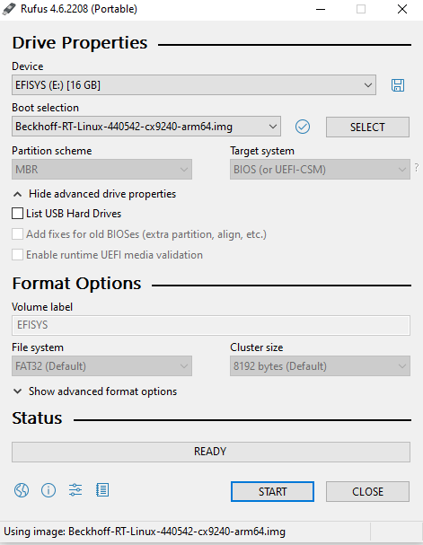
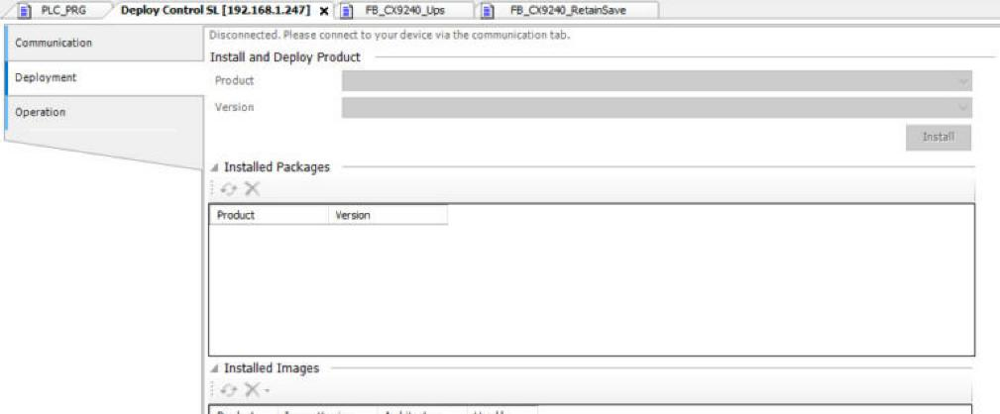
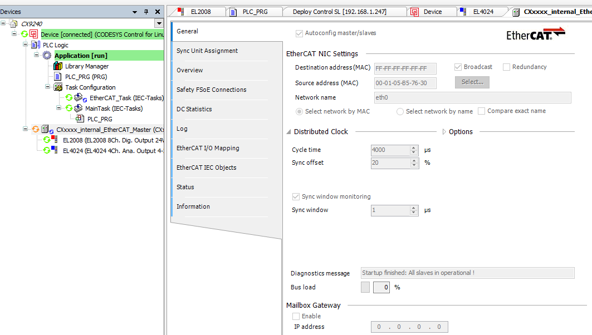
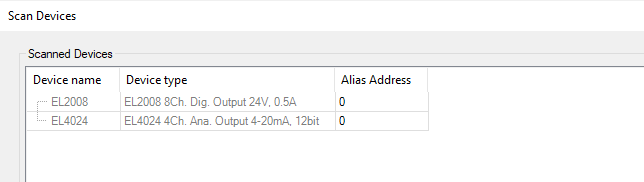
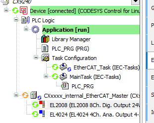
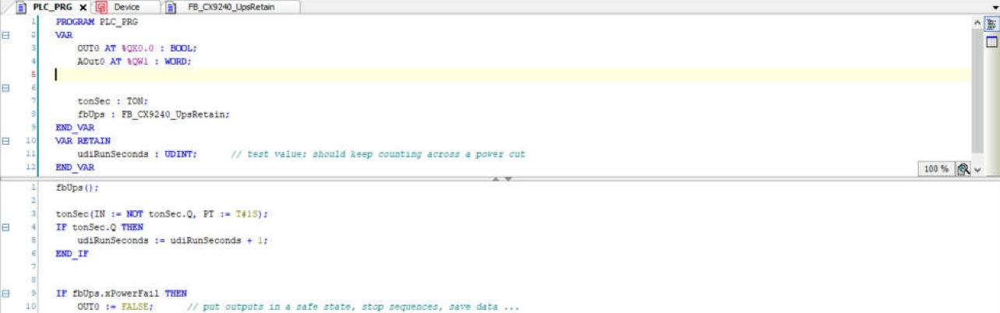

# CX9240 with CODESYS: quick install

Nov 22, 2026

Follow the steps in order. Each one is a single action or a command to copy. Background and explanations are in the [full setup guide](full-setup-guide.md).

In the commands, replace `192.168.1.247` with your controller's address.

## Before you start

Have these ready:

- [ ] CX9240 with its terminals, and 24 V wired to **both** the system and the field supply
- [ ] microSD card (16 GB) and a card reader
- [ ] Network cable, on a network that hands out addresses automatically
- [ ] myBeckhoff login (e-mail and password)
- [ ] Windows PC with Rufus, CODESYS V3.5 SP22, and the add-on *CODESYS Control for Linux ARM64 SL*
- [ ] The file `ccat-cx9240-dkms_1.0-7_all.deb`
- [ ] The file `FB_CX9240_UpsRetain.st` (only if you want power-fail data saving)

## Part 1: Prepare the controller

### Step 1. Download the image

1. Open the [Beckhoff RT Linux (CX9240) download](https://www.beckhoff.com/en-en/support/download-finder/search-result/?download_group=829549649) and sign in.
2. Download the ZIP and unpack it. You need the file ending in `-cx9240-arm64.img`.

### Step 2. Write it to the microSD card

**This erases the card.**

1. Take the microSD card out of the powered-off controller and put it in the PC's card reader.
2. Start Rufus.
3. **Device**: choose the microSD card.
4. **SELECT**: choose the `.img` file.
5. Click **START** and confirm.
6. Wait until the bar says **READY**, then close Rufus and eject the card.


*Rufus ready to write: the microSD card under Device, the image under Boot selection, and START at the bottom.*

### Step 3. Start the controller

1. Put the card back in the controller.
2. Plug in the network cable and switch on the 24 V supply.
3. Wait one minute.
4. Find the controller's address in your router's device list, or use Angry IP Scanner. The controller's name starts with `BTN-`.

### Step 4. Log in

In a Command Prompt on the PC:

```
ssh Administrator@192.168.1.247
```

Type `yes` if asked, then the Administrator password. Leave this window open; the commands in Part 2 are typed here unless stated otherwise.

## Part 2: Install the software on the controller

### Step 5. Enter your myBeckhoff login

1. Open a new file:

```
sudo nano /etc/apt/auth.conf.d/bhf.conf
```

2. Type these lines, with your own e-mail and password:

```
machine deb.beckhoff.com
login your@email.com
password yourpassword

machine deb-mirror.beckhoff.com
login your@email.com
password yourpassword
```

3. Save and close: **Ctrl+O**, **Enter**, **Ctrl+X**.
4. Run:

```
sudo chmod 600 /etc/apt/auth.conf.d/bhf.conf
sudo apt update
```

### Step 6. Install the driver package

1. On the **PC**, in a second Command Prompt opened in the folder that holds the `.deb` file:

```
scp ccat-cx9240-dkms_1.0-7_all.deb Administrator@192.168.1.247:
```

2. Back in the controller window:

```
sudo apt install ./ccat-cx9240-dkms_1.0-7_all.deb
```

This takes a few minutes. The **TC** light on the controller turns red when it is done. That is correct for now.

### Step 7. Install the CODESYS runtime

This step is done in CODESYS on the PC.

1. **Tools → Deploy Control SL**.
2. **Communication** page: enter the controller's address, user `Administrator` and its password, and connect.
3. **Deployment** page: Product **CODESYS Control for Linux ARM64 SL**, Version **4.21.0.0**, then **Install**.
4. Wait until it finishes.


*The Deploy Control SL tab. Communication and Deployment are on the left; Product, Version and Install are on the Deployment page. The lists are empty here because the picture was taken before connecting.*

### Step 8. Allow CODESYS through the firewall

1. In the controller window, open a new file:

```
sudo nano /etc/nftables.conf.d/60-codesys.conf
```

2. Type:

```
table inet filter {
  chain input {
    tcp dport { 1217, 11740 } accept
    udp dport 1740-1743 accept
  }
}
```

3. Save and close: **Ctrl+O**, **Enter**, **Ctrl+X**.
4. Run:

```
sudo systemctl reload nftables
sudo systemctl restart codesyscontrol
```

## Part 3: Set up the CODESYS project

All of Part 3 is done in CODESYS on the PC.

### Step 9. Create the project and connect

1. New **Standard project**, device **CODESYS Control for Linux ARM64 SL**.
2. Double-click **Device → Communication Settings → Scan Network** and pick the controller.
3. When asked, create a user name and password, and accept the certificate.

### Step 10. Install the terminal description files

1. Get the Beckhoff description files, one of two ways:
   - **Without TwinCAT:** download [Beckhoff\_EtherCAT\_XML.zip](https://download.beckhoff.com/download/configuration-files/io/ethercat/xml-device-description/Beckhoff_EtherCAT_XML.zip) (about 60 MB) from Beckhoff's [download folder](https://download.beckhoff.com/download/configuration-files/io/ethercat/xml-device-description/) and unpack it to a folder of your choice. No sign-in is needed.
   - **With TwinCAT installed:** the same files are already in `C:\TwinCAT\3.1\Config\Io\EtherCAT\`.
2. In CODESYS: **Tools → Device Repository → Install**.
3. Browse to that folder and select the files for your terminals. There is one file per terminal family, named after it: for example `Beckhoff EL2xxx.xml` for an EL2008 and `Beckhoff EL4xxx.xml` for an EL4024.

### Step 11. Add the EtherCAT master

1. Right-click **Device → Add Device → Fieldbuses → EtherCAT → Master** and add the master.
2. Open the master's **General** tab, click **Select...**, and choose **eth0**.


*The master's General tab with `eth0` selected. The Cycle time box used for the optional faster cycle is on the same tab.*

### Step 12. Find the terminals

Do these in this order:

1. **Online → Login**, accept the download, and press **Start**.
2. Right-click the master → **Scan for Devices**.
3. Click **Copy All Devices to Project**.
4. **Logout**, then **Login** again, accept the download, and press **Start**.


*The scan result: one line per terminal.*

The master and all terminals now show green, and the **TC** light on the controller is green.


*What a working system looks like: green symbols next to the application, the master and each terminal.*

### Step 13. Use the terminals in your program

Open each terminal's **EtherCAT I/O Mapping** tab to see its addresses, and use those addresses for your variables.

### Optional: faster cycle time

1. Logout. Open the master's **General** tab and set **Cycle time** (in µs), for example `1000` for 1 ms.
2. Login, download, Start.

Use 1000 or higher.

### Optional: keep data through a power cut

1. **Library Manager**: add **SysFile** and **CmpApp**.
2. Add a function block named `FB_CX9240_UpsRetain`, and paste in the contents of the file `FB_CX9240_UpsRetain.st`.
3. In your program, declare the data to keep under `VAR RETAIN`, and add:

```
VAR
    fbUps : FB_CX9240_UpsRetain;
END_VAR

fbUps();
```


*A program using the block: the `fbUps` line in the upper part, the `fbUps();` call in the lower part, and a counter under `VAR RETAIN` as the data to keep.*

4. Download and Start.

## Part 4: Check it works

- [ ] The **TC** light is green while the program runs, and red when you stop it.
- [ ] In CODESYS, the master and every terminal are green.
- [ ] Outputs switch when the program sets them.
- [ ] Switch the controller off and on again: after about a minute everything comes back by itself, and the TC light is green.

### What the TC light means

| TC light | Meaning |
| --- | --- |
| Green | The program is running |
| Red | The program is stopped, or the controller is still starting |

### If something goes wrong

| Problem | Do this |
| --- | --- |
| `apt` says `401 Unauthorized` | Check the e-mail and password in step 5 |
| CODESYS cannot find the controller | Redo step 8 |
| Scan says "stack is not available" | Do step 12 in the order shown |
| Scan says "device was not found in the repository" | Do step 10 for that terminal type |
| Everything is green, but an output does nothing | Check the 24 V **field** supply wiring |
| Analog output stays at minimum | Use values from 0 to 32767 |
| Master stays red after a restart | In the controller window: `sudo systemctl restart codesyscontrol` |
| Program stops after about two hours | The runtime has no licence. Restart it, or buy a licence |

### Good to know

- Outputs switch off immediately when the 24 V supply is lost. Nothing can prevent that.
- Downloading a changed project usually resets the saved RETAIN data.
- This setup was tested on one controller with two terminals. It is not a supported Beckhoff or CODESYS product.
