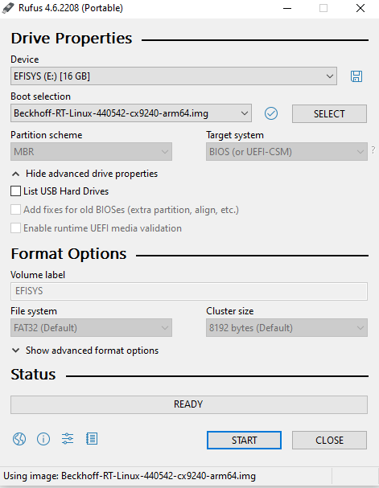
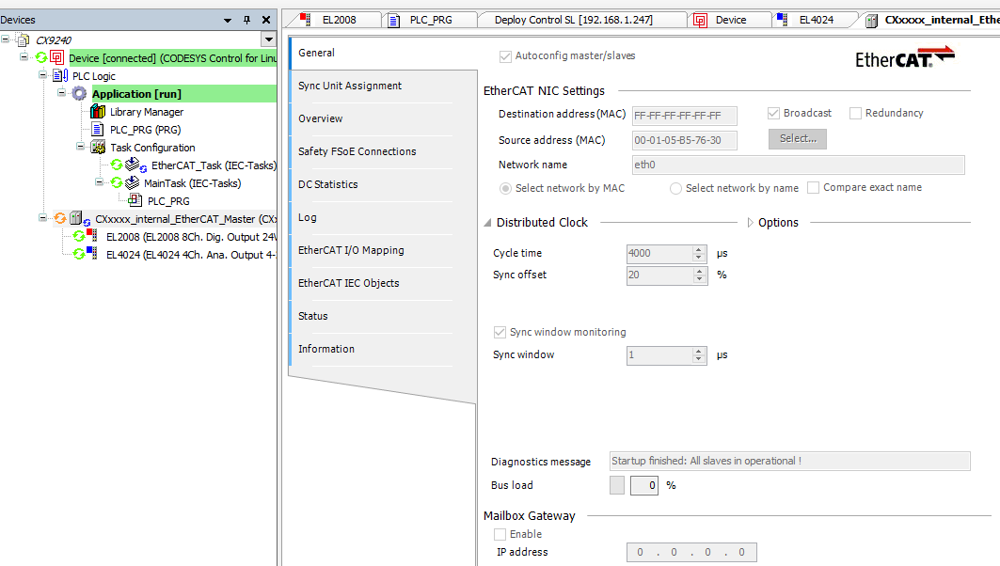
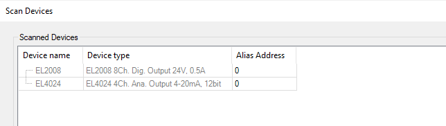
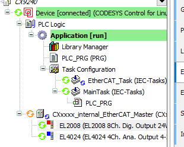
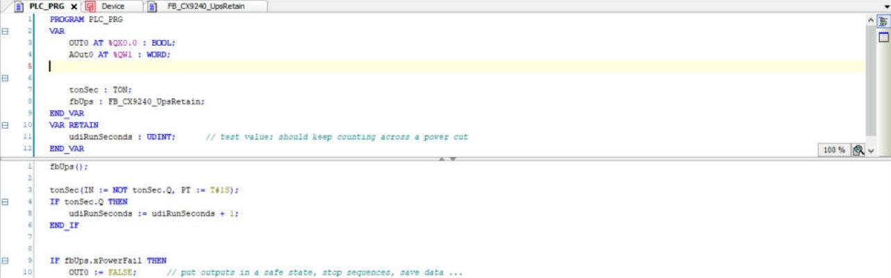

# CX9240 with CODESYS: scripted install

Nov 22, 2026

This version of the install uses one script on the PC in place of the typed commands on the controller. The steps before it (preparing the card) and after it (the CODESYS project) are the same as in the [quick install](quick-install.md).

> **Tested once.** The script was run on a freshly flashed controller on 22 November 2026 and finished with every check `OK`; CODESYS then connected and ran a project on it. If it ever stops with an error, steps 5 to 8 of the quick install do the same four things by hand.

## Before you start

Have these ready:

- [ ] CX9240 with its terminals, and 24 V wired to **both** the system and the field supply
- [ ] microSD card (16 GB) and a card reader
- [ ] Network cable, on a network that hands out addresses automatically
- [ ] myBeckhoff login (e-mail and password)
- [ ] A newly imaged controller (the script expects the default Administrator password)
- [ ] Windows PC with Rufus, CODESYS V3.5 SP22, and the add-on *CODESYS Control for Linux ARM64 SL*
- [ ] The `setup_script` folder, containing `Install-CX9240.cmd`, `Install-CX9240.ps1` and `setup-controller.sh`
- [ ] The file `ccat-cx9240-dkms_1.0-7_all.deb`, copied into the `setup_script` folder

The PC must be able to reach the controller over the network, and the controller needs internet access during the setup.

## Part 1: Prepare the controller

### Step 1. Download the image

1. Open the [Beckhoff RT Linux (CX9240) download](https://www.beckhoff.com/en-en/support/download-finder/search-result/?download_group=829549649) and sign in.
2. Download the ZIP and unpack it. You need the file ending in `-cx9240-arm64.img`.

### Step 2. Write it to the microSD card

**This erases the card.**

1. Take the microSD card out of the powered-off controller and put it in the PC's card reader.
2. Start Rufus.
3. **Device**: choose the microSD card.
4. **SELECT**: choose the `.img` file.
5. Click **START** and confirm.
6. Wait until the bar says **READY**, then close Rufus and eject the card.


*Rufus ready to write: the microSD card under Device, the image under Boot selection, and START at the bottom.*

### Step 3. Start the controller

1. Put the card back in the controller.
2. Plug in the network cable and switch on the 24 V supply.
3. Wait one minute.
4. Find the controller's address in your router's device list (the name starts with `BTN-`). A network scanner such as Angry IP Scanner can also be used to find it. Write it down.

## Part 2: Run the setup script

This script sets up the myBeckhoff login for the controller, the driver package, the CODESYS runtime and the firewall rule.

### Step 4. Run the script

1. On the PC, open the `setup_script` folder and double-click **Install-CX9240.cmd**.
2. Answer the questions as they appear. Passwords are not shown while you type.

| The window asks | Type |
| --- | --- |
| `Controller address` | The address from step 3, for example `192.168.1.247` |
| `myBeckhoff e-mail:` | Your myBeckhoff e-mail address |
| `myBeckhoff password (not shown):` | Your myBeckhoff password |

The script does not ask for the controller's own password. It uses the one every newly imaged controller has: user `Administrator`, password `1`.

3. Wait. The script works through five steps and says which one it is on. Steps 2 and 3 of 5 each take several minutes on a new card, and the last step is silent for a minute or more before the checks appear. It can look stuck; leave the window alone until the checks are printed.
4. At the end it prints a list of checks. Every line should start with `OK`:

```
  OK    Driver built for this kernel
  OK    EtherCAT interface eth0 is up
  OK    Driver service running
  OK    CODESYS runtime running
  OK    TC LED service running
  OK    Firewall rule loaded
  OK    UPS entry in CODESYS configuration
  OK    UPS signal readable

All checks passed. Continue in CODESYS on the PC
```

5. Press a key to close the window.

The **TC** light on the controller is red at this point. That is correct until a program is running.

### If the script stops

| Message | Do this |
| --- | --- |
| `STOPPED: Copy failed` | Check the address and that the controller is on, then run the script again. If the controller's password has been changed from the default, see below |
| A warning that the host key has changed | In a Command Prompt, run `ssh-keygen -R 192.168.1.247` with your address, then run the script again |
| `That login was not accepted` | Retype the myBeckhoff e-mail and password. Three wrong tries end the script |
| `STOPPED: No CODESYS installation ... was found` | Install the *CODESYS Control for Linux ARM64 SL* add-on in CODESYS |
| `STOPPED: Driver package ... not found` | Copy the `.deb` file into the `setup_script` folder |
| `FAILED:` followed by a step, or a line starting with `FAIL` | Run the script again. If it fails the same way, do steps 5 to 8 of the quick install by hand |

Running the script again is safe. It repeats or skips what is already done and does not ask for the myBeckhoff login a second time.

### Running it from PowerShell instead

```
cd setup_script
.\Install-CX9240.ps1 -Address 192.168.1.247
```

If the controller's password is no longer the default, add `-AskPassword` and type it when asked:

```
.\Install-CX9240.ps1 -Address 192.168.1.247 -AskPassword
```

### After the setup: change the default password

A controller that still has the password `1` can be taken over by anyone on the same network. Once the setup has finished, log in and set a new one:

```
ssh Administrator@192.168.1.247
passwd
```

From then on, run the script with `-AskPassword`.

## Part 3: Set up the CODESYS project

All of Part 3 is done in CODESYS on the PC. It is the same as in the quick install.

### Step 5. Create the project and connect

1. New **Standard project**, device **CODESYS Control for Linux ARM64 SL**.
2. Double-click **Device → Communication Settings → Scan Network** and pick the controller.
3. When asked, create a user name and password, and accept the certificate.

### Step 6. Install the terminal description files

1. Get the Beckhoff description files, one of two ways:
   - **Without TwinCAT:** download [Beckhoff\_EtherCAT\_XML.zip](https://download.beckhoff.com/download/configuration-files/io/ethercat/xml-device-description/Beckhoff_EtherCAT_XML.zip) (about 60 MB) from Beckhoff's [download folder](https://download.beckhoff.com/download/configuration-files/io/ethercat/xml-device-description/) and unpack it to a folder of your choice. No sign-in is needed.
   - **With TwinCAT installed:** the same files are already in `C:\TwinCAT\3.1\Config\Io\EtherCAT\`.
2. In CODESYS: **Tools → Device Repository → Install**.
3. Browse to that folder and select the files for your terminals. There is one file per terminal family, named after it: for example `Beckhoff EL2xxx.xml` for an EL2008 and `Beckhoff EL4xxx.xml` for an EL4024.

### Step 7. Add the EtherCAT master

1. Right-click **Device → Add Device → Fieldbuses → EtherCAT → Master** and add the master.
2. Open the master's **General** tab, click **Select...**, and choose **eth0**.


*The master's General tab with `eth0` selected.*

### Step 8. Find the terminals

Do these in this order:

1. **Online → Login**, accept the download, and press **Start**.
2. Right-click the master → **Scan for Devices**.
3. Click **Copy All Devices to Project**.
4. **Logout**, then **Login** again, accept the download, and press **Start**.


*The scan result: one line per terminal.*

The master and all terminals now show green, and the **TC** light on the controller is green.


*What a working system looks like: green symbols next to the application, the master and each terminal.*

### Step 9. Use the terminals in your program

Open each terminal's **EtherCAT I/O Mapping** tab to see its addresses, and use those addresses for your variables.

### Optional: keep data through a power cut

1. **Library Manager**: add **SysFile** and **CmpApp**.
2. Add a function block named `FB_CX9240_UpsRetain`, and paste in the contents of the file `FB_CX9240_UpsRetain.st`. The file is in the project's `ups_test` folder; the driver package also puts a copy on the controller in `/usr/share/doc/ccat-cx9240-dkms/examples/`.
3. In your program, declare the data to keep under `VAR RETAIN`, and add:

```
VAR
    fbUps : FB_CX9240_UpsRetain;
END_VAR

fbUps();
```

4. Download and Start.


*A program using the block: the `fbUps` line in the upper part, the `fbUps();` call in the lower part, and a counter under `VAR RETAIN` as the data to keep.*

### Optional: faster cycle time

1. Logout. Open the master's **General** tab and set **Cycle time** (in µs), for example `1000` for 1 ms.
2. Login, download, Start.

Use 1000 or higher.

## Part 4: Check it works

- [ ] The **TC** light is green while the program runs, and red when you stop it.
- [ ] In CODESYS, the master and every terminal are green.
- [ ] Outputs switch when the program sets them.
- [ ] Switch the controller off and on again: after about a minute everything comes back by itself, and the TC light is green.

### If something goes wrong in CODESYS

| Problem | Do this |
| --- | --- |
| CODESYS cannot find the controller | Run the setup script again and check that `Firewall rule loaded` says `OK` |
| Scan says "stack is not available" | Do step 8 in the order shown |
| Scan says "device was not found in the repository" | Do step 6 for that terminal type |
| Everything is green, but an output does nothing | Check the 24 V **field** supply wiring |
| Analog output stays at minimum | Use values from 0 to 32767 |
| Program stops after about two hours | The runtime has no licence. Restart it, or buy a licence |

### Good to know

- The script stores your myBeckhoff login on the controller, in a file only the controller's administrator can read. Nothing you type is kept on the PC.
- Outputs switch off immediately when the 24 V supply is lost. Nothing can prevent that.
- This setup was tested on one controller with two terminals. It is not a supported Beckhoff or CODESYS product.
